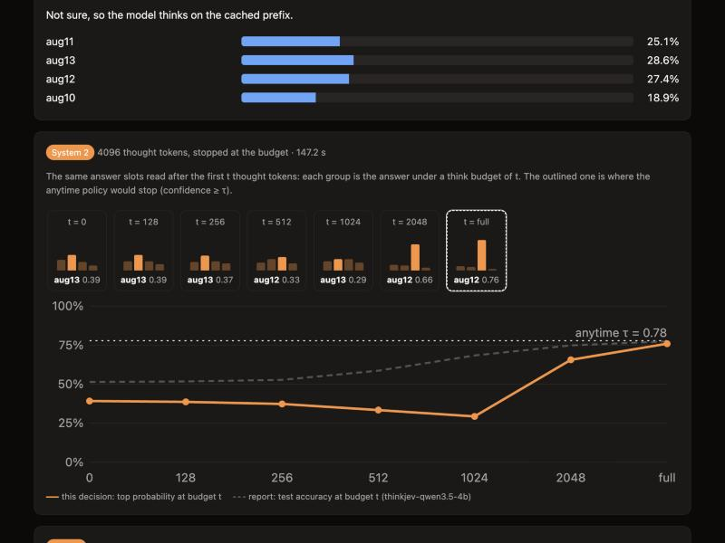
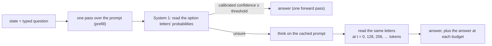

<div align="center">

# ThinkJev

**The same model answers instantly when sure and thinks when not, with calibrated probabilities either way.**

[](LICENSE)
[](pyproject.toml)
[](#bundled-models)
[](https://arxiv.org/abs/2610.37732)

English | [中文](README.zh-CN.md)

</div>

ThinkJev uses the same open LLM both to answer directly and to answer after thinking, so there is
no second reasoning model to deploy. The model must be hybrid-thinking, i.e. able to answer
directly or think first (such as Qwen3.5). You send a state (the facts to decide on, as JSON) and
questions with fixed answers (choice, yes/no, or score), and get back a calibrated probability for
every option. The model answers directly, from a single forward pass, when it is confident, and
thinks first only when it is not. We call the direct answer System 1 and the answer after
thinking System 2. Requests use the format of TypeSafe Jev's public API.

<p align="center">
  
  <br>
  <em>The built-in demo page (Qwen3.5-4B, a date question). Top: the direct answer's top probability is 0.29, below the threshold of 0.71, so the model thinks. Bottom: the answer read after t thought tokens; bars are the option probabilities, the solid line the top probability, the dashed line the model's test accuracy at each budget. The answer settles on the correct aug12 only after 2,048 tokens.</em>
</p>

## Highlights

- **Direct answers in one forward pass.** One pass over the prompt, then the logits of the option
  letters: calibrated probabilities with no text generated or parsed (155 ms median for Qwen3.5-4B on one H200).
- **An error guarantee for direct answers.** Probabilities are calibrated by temperature scaling
  (expected calibration error 0.024–0.037). Whether System 1 answers directly is decided by a threshold chosen on a dev split
  with Learn-then-Test, a statistical test that keeps the error rate of the direct answers under a
  target you set (for example 5%).
- **Thinks only when unsure, at any budget.** When the direct answer is unsure, the model thinks,
  continuing from the cached prompt, and the same option letters are read after the thought. Reading them after *t* thought tokens gives exactly the answer under a
  budget of *t* tokens, so one thought yields the answer at every budget.
- **No training.** Only two temperatures and a threshold are fit, on labeled examples, in seconds
  on a CPU. The values for four models ship with the package.
- **Compatible with Jev's API.** `POST /v1/systemone` takes TypeSafe's public request format, so
  code written for TypeSafe's Python SDK runs against a local ThinkJev server unchanged.

## Results

8,359 test decisions from three kinds of task: routine tasks (intent routing, natural language
inference, judgment questions);
multi-step decisions, namely dates, counting, arithmetic, scheduling, and more (generated by code,
with labels computed by code) plus chess puzzles; and public reasoning benchmarks. Temperatures and
thresholds are chosen on a dev split; the test split is used only for evaluation.

| Model | Always answer directly | Always think | Think only when unsure | Answered directly at a 5% error target |
|---|---:|---:|---:|---:|
| Qwen3.5-4B | 50.9% | 77.4% | 76.5%, with 83% of the thought tokens | 6.5% of decisions, 1.1% error |
| Qwen3.5-9B | 54.1% | 80.0% | 78.9%, with 82% of the thought tokens | none (no decision qualifies) |
| Qwen3.5-27B | 62.2% | 82.7% | 81.6%, with **72%** of the thought tokens | **24.5%** of decisions, **3.9%** error |
| Qwen3.8-27B | 60.2% | 81.8% | 80.8%, with 85% of the thought tokens | 23.2% of decisions, 4.2% error |

The first three columns are accuracy. "Think only when unsure" is the anytime policy: it thinks
only when the direct answer is unsure and stops thinking as soon as the answer is confident; its
threshold is chosen on dev so that accuracy stays within one point of always thinking. The last
column is the share of decisions answered without thinking when the error target is 5%, and the
error rate those answers actually had on test.

With Qwen3.5-27B, about one decision in four is answered directly with an error rate under 5%,
and only the rest think.

## Installation

Requires Python 3.10+ and an NVIDIA GPU. The bf16 weights
take about 8 GB for Qwen3.5-4B, 18 GB for 9B, and 54 GB for the 27B models.

```bash
pip install "thinkjev @ git+https://github.com/ding-xiaolu/ThinkJev.git"
```

Or from source:

```bash
git clone https://github.com/ding-xiaolu/ThinkJev.git && cd ThinkJev
pip install -e .
```

## Quick start

### Server and demo page

```bash
thinkjev-serve --preset qwen3.5-4b
# POST http://127.0.0.1:8000/v1/systemone, demo page at http://127.0.0.1:8000/
```

`--preset` downloads a fixed version of the model and loads the calibration that ships with this
repository. The demo page runs a decision live: the direct answer's probabilities against the
threshold, then, if the model thinks, the answer read at every checkpoint of the thought.

```bash
curl http://127.0.0.1:8000/v1/systemone -H 'Content-Type: application/json' -d '{
  "state": {"invoice": "Issued Sep 15, net-60 terms; paid Nov 16."},
  "questions": {
    "late": {"type": "noul", "instructions": "Was the payment late?"},
    "team": {"type": "choice", "instructions": "Which team should handle it?",
             "criteria": {"billing": "Payments and refunds", "legal": "Contract disputes"}}
  }
}'
```

Each answer comes in Jev's response format, plus a `thinkjev` trace per question: which system
answered, System 1's calibrated confidence, thought tokens, and time. Add
`"thinkjev": {"stream": true}` to receive the same events as a server-sent event stream.

### TypeSafe SDK

Point existing code at the local server:

```bash
TYPESAFE_BASE_URL=http://127.0.0.1:8000 TYPESAFE_API_KEY=local python your_jev_script.py
```

### Python

```python
from thinkjev import ThinkJev

tj = ThinkJev.from_preset("qwen3.5-4b")
out = tj.system_one(
    state={"invoice": "Issued Sep 15, net-60 terms; paid Nov 16."},
    questions={"late": {"type": "noul", "instructions": "Was the payment late?"}},
)
print(out["answers"]["late"]["noul"], out["thinkjev"]["late"]["system"])  # probability; "s1" direct, "s2" after thinking
```

### Options

| Flag | Default | Meaning |
|---|---|---|
| `--preset` | | A bundled model and calibration (see below) |
| `--model`, `--revision` | | Any Hugging Face model instead of a preset; `--revision` is the model's commit hash, so every download gets the same weights |
| `--s1-temperature`, `--s2-temperature`, `--threshold` | from the preset | Override the preset's calibration with values fit on your own labeled data |
| `--think-budget` | 4096 with a preset | Maximum thought tokens |
| `--think-default` | `auto` | `auto` thinks when unsure; `never` always answers directly, `always` always thinks (also per request) |
| `--api-key` | none | Require this bearer token on every request |

The bundled temperatures and thresholds were fit on the evaluation data above. Probabilities transfer best to
similar tasks; for a production workload, fit the two temperatures and the threshold on labeled
examples from that workload. Questions take up to 16 options or levels.

## How it works



1. **System 1 (direct answer).** The question and options go into a fixed prompt template, with
   the options labeled A, B, …. One forward pass gives a logit per letter; a temperature turns them
   into calibrated probabilities. The options are also read in rotated orders and averaged, which
   removes the model's preference for some positions.
2. **The gate.** If System 1's top probability reaches the threshold, System 1 answers. The
   threshold is chosen with Learn-then-Test, so that, with high probability, the error rate of
   these direct answers stays under the target you chose.
3. **System 2 (answer after thinking).** Otherwise the model thinks on the cached prompt (the
   prompt is not processed again) and reads the same letters after the thought, calibrated with its
   own temperature.
4. **Anytime readout.** The letters are also read at checkpoints during the thought. The reading at
   *t* tokens is the answer under a budget of *t*, so a single thought gives the whole
   accuracy–budget curve, with System 1 as its *t* = 0 end.

## Bundled models

| Preset | Model | Version (commit) | Threshold |
|---|---|---|---:|
| `qwen3.5-4b` | [Qwen/Qwen3.5-4B](https://huggingface.co/Qwen/Qwen3.5-4B) | `851bf6e` | 0.71 |
| `qwen3.5-9b` | [Qwen/Qwen3.5-9B](https://huggingface.co/Qwen/Qwen3.5-9B) | `c202236` | 0.81 |
| `qwen3.5-27b` | [Qwen/Qwen3.5-27B](https://huggingface.co/Qwen/Qwen3.5-27B) | `fc05dae` | 0.79 |
| `qwen3.8-27b` | [Qwen/Qwen3.8-27B](https://huggingface.co/Qwen/Qwen3.8-27B) | `1d4bf0f` | 0.73 |

Each preset fixes the model to a full commit hash, so the downloaded weights are the ones we
evaluated; the calibration file is in
[`src/thinkjev/calibrations/`](src/thinkjev/calibrations).

## Reproducing the report

The per-decision outputs and reports of the release runs are attached to the
[v0.1.0 release](https://github.com/ding-xiaolu/ThinkJev/releases/tag/v0.1.0) as
`results.tar.gz` (IDs, logits, token counts, and timings; no decision text). From them, every
figure and number of the report is regenerated on a CPU in minutes. Rebuilding the decisions and
rerunning the models needs GPUs. Both are described in
[benchmarks/README.md](benchmarks/README.md); `pytest -q` runs the tests on a CPU.

## Citation

Please cite the technical report ([arXiv:2610.37732](https://arxiv.org/abs/2610.37732)):

```bibtex
@misc{thinkjev2026,
  title         = {ThinkJev: One Thought, Every Budget for Calibrated Typed Decisions},
  author        = {Ding, Xiaolu and Yang, Kai and Liu, Dongdong},
  year          = {2026},
  eprint        = {2610.37732},
  archivePrefix = {arXiv},
  primaryClass  = {cs.AI},
  url           = {https://arxiv.org/abs/2610.37732}
}
```

## Acknowledgements

System 1's prompt template, option readout, and temperature scaling are vendored from
[SemIf](https://github.com/TheoLeeCJ/SemIf) (MIT). Option rotations and the coverage-at-risk view
follow [AnyJev](https://github.com/nokia-applied-research/AnyJev). See
[THIRD_PARTY.md](THIRD_PARTY.md).

ThinkJev is an independent project, not affiliated with or endorsed by TypeSafe. Jev is TypeSafe
AI's product; ThinkJev shares only its public request format and never calls the Jev API.

## License

[MIT](LICENSE)
