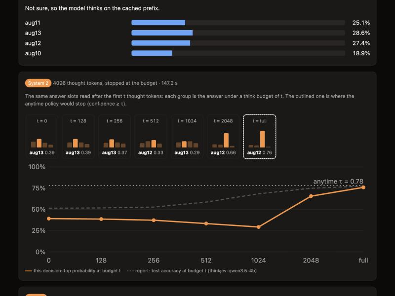
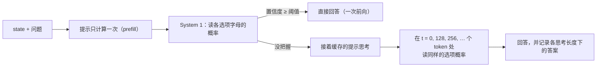

<div align="center">

# ThinkJev

**同一个模型，有把握就直接回答，没把握再思考，答案都带校准概率。**

[](LICENSE)
[](pyproject.toml)
[](#内置模型)
[](https://arxiv.org/abs/2610.37732)

[English](README.md) | 中文

</div>

ThinkJev 让同一个开源大模型既负责直接回答，也负责思考后回答，不需要另外部署推理模型。模型须支持混合思考，即既能直接
回答、也能先思考再回答（如 Qwen3.5）。输入上下文（`state`，即作出判断所依据的事实，JSON 格式）和若干答案固定的问题（单选、是/否、打分），返回每个选项的
校准概率：模型有把握时只做一次前向计算就直接回答；没把握时才继续思考，并复用已经算好的提示缓存。下文把直接回答称为
System 1，思考后回答称为 System 2。请求格式与 TypeSafe Jev 的公开接口一致。

<p align="center">
  
  <br>
  <em>内置演示页面（Qwen3.5-4B，问题是推算日期）。上方：直接回答时最高概率只有 0.29，低于阈值 0.71，于是模型开始思考。
  下方：思考到第 t 个 token 时读出的答案，柱子是各选项的概率，实线是最高概率，虚线是该模型在测试集上的平均准确率；
  思考到 2048 个 token 时，答案才稳定在正确的 aug12。</em>
</p>

## 亮点

- **直接回答只需一次前向。** 对提示做一次前向计算，直接读出各选项字母的概率，不生成、也不解析文本
  （Qwen3.5-4B 在单张 H200 上耗时中位数 155 ms）。
- **直接回答的错误率有统计保证。** 概率经过温度缩放校准（期望校准误差 ECE 为 0.024–0.037）。是否直接回答由阈值决定；
  阈值用统计检验方法 Learn-then-Test 在验证集上选定，保证直接回答的那部分决策错误率不超过设定的目标（如 5%）。
- **没把握才思考，思考长度可任意设定。** 思考接着已缓存的提示进行，结束后读同样的选项概率。思考到第 t 个 token
  时读一次，得到的就是“最多只允许思考 t 个 token”时的答案，所以一次思考就能得到所有思考长度下的答案。
- **无需训练。** 只需拟合两个温度和一个阈值，用带标签的样本在 CPU 上几秒钟即可完成；仓库内置了四个模型的参数。
- **接口与 Jev 兼容。** 提供 `POST /v1/systemone`，请求格式与 TypeSafe 公开的一致；基于 TypeSafe Python SDK
  写的代码无需修改，就能调用本地的 ThinkJev 服务。

## 结果

测试集共 8359 个决策，来自三类任务：常规任务（意图识别、自然语言推理、判断类问题）；多步推理决策，包括日期、计数、算术、
排程等（样本由程序生成，标签由代码计算）和国际象棋战术题；以及公开推理基准。温度和阈值都在验证集上选定，测试集只用于评估。

| 模型 | 全部直接回答 | 全部思考 | 按需思考（Anytime） | 直接回答的部分（目标错误率 5%） |
|---|---:|---:|---:|---:|
| Qwen3.5-4B | 50.9% | 77.4% | 76.5%，思考量为全部思考的 83% | 6.5% 的决策，实际错误率 1.1% |
| Qwen3.5-9B | 54.1% | 80.0% | 78.9%，思考量为全部思考的 82% | 0（没有决策达到要求） |
| Qwen3.5-27B | 62.2% | 82.7% | 81.6%，思考量为全部思考的 **72%** | **24.5%** 的决策，实际错误率 **3.9%** |
| Qwen3.8-27B | 60.2% | 81.8% | 80.8%，思考量为全部思考的 85% | 23.2% 的决策，实际错误率 4.2% |

前三列是准确率。按需思考：没把握的决策才思考，且答案一有把握就停止；阈值在验证集上选定，使准确率比全部思考低不超过
1 个百分点。最后一列：目标错误率为 5% 时，有多少决策可以不经思考直接回答，以及这些决策在测试集上的实际错误率。

以 Qwen3.5-27B 为例，约四分之一的决策可以直接回答，且错误率低于 5%，其余的才需要思考。

## 安装

需要 Python 3.10+ 和一张 NVIDIA GPU。bf16 权重约占显存：Qwen3.5-4B 8 GB，9B 18 GB，27B 54 GB。

```bash
pip install "thinkjev @ git+https://github.com/ding-xiaolu/ThinkJev.git"
```

或从源码安装：

```bash
git clone https://github.com/ding-xiaolu/ThinkJev.git && cd ThinkJev
pip install -e .
```

## 快速上手

### 服务与演示页面

```bash
thinkjev-serve --preset qwen3.5-4b
# 接口 POST http://127.0.0.1:8000/v1/systemone，演示页面 http://127.0.0.1:8000/
```

`--preset` 会下载固定版本的模型，并加载仓库自带的校准参数。演示页面会现场演示决策过程：先显示直接回答的各选项概率和阈值；
如果模型开始思考，再逐个显示思考过程中各检查点读出的答案。

```bash
curl http://127.0.0.1:8000/v1/systemone -H 'Content-Type: application/json' -d '{
  "state": {"invoice": "Issued Sep 15, net-60 terms; paid Nov 16."},
  "questions": {
    "late": {"type": "noul", "instructions": "Was the payment late?"},
    "team": {"type": "choice", "instructions": "Which team should handle it?",
             "criteria": {"billing": "Payments and refunds", "legal": "Contract disputes"}}
  }
}'
```

返回格式与 Jev 相同，每个问题另附一条 `thinkjev` 记录：由哪个系统回答、直接回答时的置信度、思考的 token 数和耗时。
请求里加上 `"thinkjev": {"stream": true}`，同样的内容会以 server-sent events 流式返回。

### TypeSafe SDK

把现有代码指向本地服务即可：

```bash
TYPESAFE_BASE_URL=http://127.0.0.1:8000 TYPESAFE_API_KEY=local python your_jev_script.py
```

### Python

```python
from thinkjev import ThinkJev

tj = ThinkJev.from_preset("qwen3.5-4b")
out = tj.system_one(
    state={"invoice": "Issued Sep 15, net-60 terms; paid Nov 16."},
    questions={"late": {"type": "noul", "instructions": "Was the payment late?"}},
)
print(out["answers"]["late"]["noul"], out["thinkjev"]["late"]["system"])  # 概率；"s1" 为直接回答，"s2" 为思考后回答
```

### 常用参数

| 参数 | 默认值 | 说明 |
|---|---|---|
| `--preset` | | 选用内置的模型和校准参数（见下文） |
| `--model`、`--revision` | | 不用 preset 时指定任意 Hugging Face 模型；`--revision` 填模型的 commit hash，保证每次下载同一版本 |
| `--s1-temperature`、`--s2-temperature`、`--threshold` | 取自 preset | 覆盖 preset 的校准参数，填你用自己业务数据拟合出的值 |
| `--think-budget` | 用 preset 时为 4096 | 最多思考多少个 token |
| `--think-default` | `auto` | `auto` 没把握才思考；`never` 只直接回答，`always` 总是思考（也可在单个请求里设置） |
| `--api-key` | 无 | 设置后，请求须带上这个 Bearer token |

内置参数是在上述评测数据上拟合的，用在相似任务上效果最好；用于生产业务时，建议用该业务的带标签样本重新拟合两个温度
和阈值。每个问题最多 16 个选项或等级。

## 原理



1. **System 1（直接回答）。** 问题和选项按固定模板写进提示，选项用字母 A、B、… 标记。一次前向计算得到每个字母的
   logit，除以温度后得到校准概率。为消除模型对选项位置的偏好，还会把选项顺序循环轮换后再读，取平均。
2. **门控。** 直接回答的最高概率不低于阈值，就直接回答。阈值用 Learn-then-Test 选定，使这部分决策的错误率以高概率
   不超过设定的目标。
3. **System 2（思考后回答）。** 否则模型接着缓存的提示思考（不重复计算提示），思考结束后读同样的字母概率，用单独拟合的温度校准。
4. **Anytime 读出。** 思考过程中也在若干检查点读一次字母概率。第 t 个 token 处的读数，就是最多只允许思考 t 个 token 时的
   答案，因此一次思考就能得到完整的“准确率—思考长度”曲线；直接回答就是这条曲线 t = 0 的一端。

## 内置模型

| Preset | 模型 | 版本（commit） | 阈值 |
|---|---|---|---:|
| `qwen3.5-4b` | [Qwen/Qwen3.5-4B](https://huggingface.co/Qwen/Qwen3.5-4B) | `851bf6e` | 0.71 |
| `qwen3.5-9b` | [Qwen/Qwen3.5-9B](https://huggingface.co/Qwen/Qwen3.5-9B) | `c202236` | 0.81 |
| `qwen3.5-27b` | [Qwen/Qwen3.5-27B](https://huggingface.co/Qwen/Qwen3.5-27B) | `fc05dae` | 0.79 |
| `qwen3.8-27b` | [Qwen/Qwen3.8-27B](https://huggingface.co/Qwen/Qwen3.8-27B) | `1d4bf0f` | 0.73 |

每个 preset 都把模型固定到完整的 commit hash，保证下载到的权重与评测时一致；校准参数文件在
[`src/thinkjev/calibrations/`](src/thinkjev/calibrations)。

## 复现技术报告

发布运行的逐题输出和评测报告作为 `results.tar.gz` 附在
[v0.1.0 release](https://github.com/ding-xiaolu/ThinkJev/releases/tag/v0.1.0) 里，只含题目 ID、logits、
token 数和耗时，不含题目文本。用它在 CPU 上几分钟就能重新生成报告里的全部图表和数字。如果要从头重建题目、
重跑模型，则需要 GPU。两种做法都写在 [benchmarks/README.md](benchmarks/README.md) 里；`pytest -q` 在 CPU 上跑全部测试。

## 引用

请引用技术报告（[arXiv:2610.37732](https://arxiv.org/abs/2610.37732)）：

```bibtex
@misc{thinkjev2026,
  title         = {ThinkJev: One Thought, Every Budget for Calibrated Typed Decisions},
  author        = {Ding, Xiaolu and Yang, Kai and Liu, Dongdong},
  year          = {2026},
  eprint        = {2610.37732},
  archivePrefix = {arXiv},
  primaryClass  = {cs.AI},
  url           = {https://arxiv.org/abs/2610.37732}
}
```

## 致谢

System 1 的提示模板、选项概率读出和温度校准代码取自 [SemIf](https://github.com/TheoLeeCJ/SemIf)（MIT）；
选项轮换和“按目标错误率看可直接回答的比例”的思路来自 [AnyJev](https://github.com/nokia-applied-research/AnyJev)。
详见 [THIRD_PARTY.md](THIRD_PARTY.md)。

ThinkJev 是独立项目，与 TypeSafe 没有隶属或背书关系。Jev 是 TypeSafe AI 的产品；ThinkJev 只沿用其公开的请求格式，
从不调用 Jev API。

## 许可

[MIT](LICENSE)
